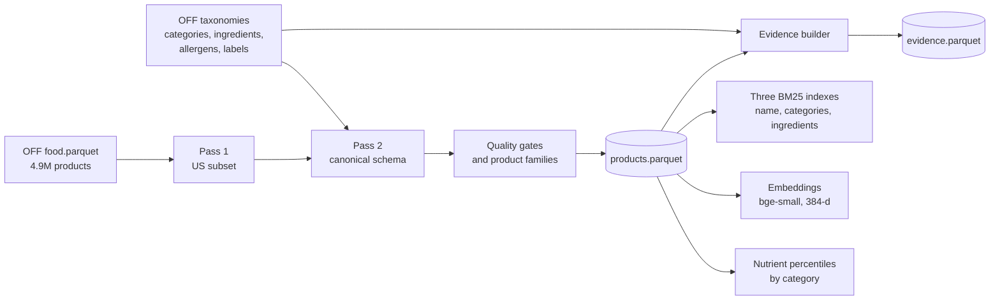
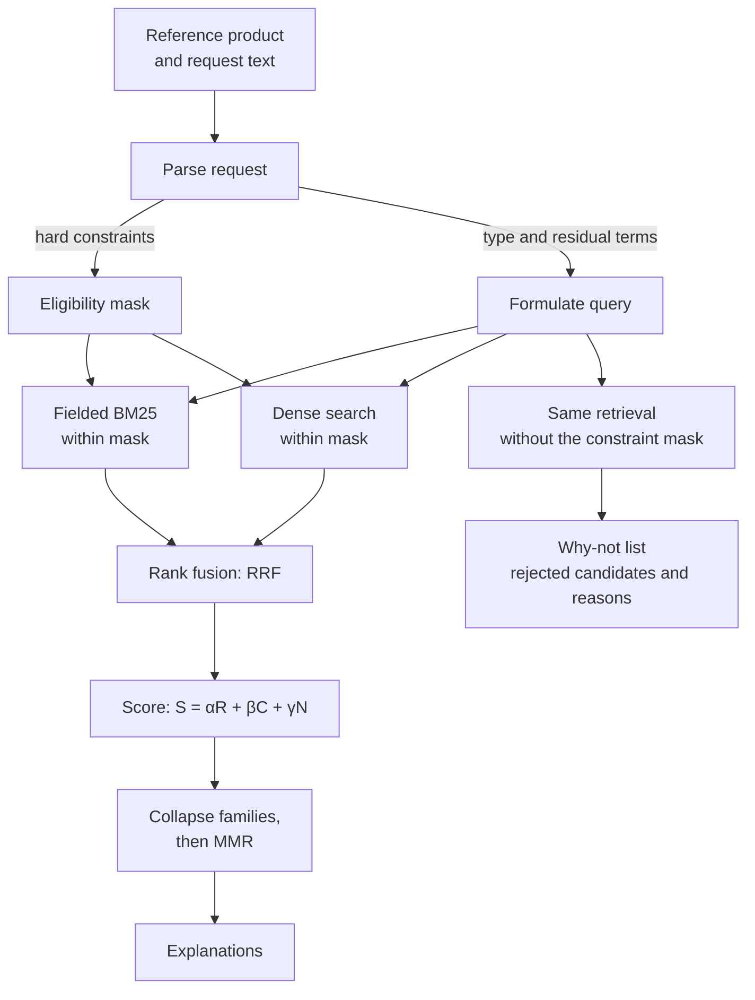

# 04 · Architecture

**Use:** design (changes to the types in section 4 go through [decisions.md](decisions.md)).
**Read by:** everyone writing code. RANK owns this document.
**Last updated:** 2026-11-10.

## 1. Shape of the system

FoodSwap has an offline half that turns the Open Food Facts dump into a corpus and indexes, and an online half that answers one request at a time.

### 1.1 Offline build



### 1.2 Online query



## 2. Five rules

1. **One row index.** After the corpus is frozen, `idx` (row position) is the document id in every index and array. The barcode is the external id in run files, labels and the UI.
2. **Constraints are masks, and search is exhaustive.** Verdicts are precomputed per product and allergen. A request turns them into a boolean mask over the whole corpus, and every retriever scores the whole masked corpus. "Fewer than five eligible products" is therefore a fact about the corpus, not an artifact of filtering a short top-K list.
3. **A system is a settings dict.** Every baseline and ablation is the full system's settings with a few values changed, all in one Python file. There are no `if system == "B2"` branches in the search code. The evaluation reads run files only, so the cached B3 run is treated like any other.
4. **Build once, share the results.** One machine builds the corpus and indexes; the others copy them. Nothing touches the network at query time.
5. **The search code never imports Streamlit.** The app and the labeling page call one search function.

## 3. Repository layout

Keep it flat, and add a module only when its first real code is written. No empty placeholders.

```
README.md            setup in four commands
requirements.txt     pinned versions, same on every laptop
foodswap/            the code, one module per stage
  schema.py          types shared by the parser, the constraint checks and the ranker
  data.py            download and check the dump; build the corpus
                     added as each stage is written: parser.py, evidence.py, search.py,
                     systems.py, evaluate.py
app.py               Streamlit search page
pages/               Streamlit compare and labeling pages
eval/                scenarios, rubric and labels (tracked in git)
tests/               added with the first logic worth testing (parser, evidence rules)
data/                downloads, corpus, indexes and runs (git-ignored)
docs/                plan, design and the original proposal (proposal.pdf)
```

## 4. Core types

`foodswap/schema.py` holds the types every role codes against:

```python
class Verdict(IntEnum):
    FAIL = 0
    PASS = 1
    UNKNOWN = 2           # the record doesn't have enough information to decide

@dataclass(frozen=True)
class Constraint:
    kind: str             # "allergen", "ingredient", "max" or "min"
    target: str           # "peanuts", "en:gelatin", "sugars"
    value: float | None   # grams per 100 g or 100 ml, for "max" and "min"

@dataclass(frozen=True)
class NutrientGoal:
    nutrient: str         # "sugars"
    direction: int        # -1 for less, +1 for more

@dataclass(frozen=True)
class ParsedRequest:
    raw: str
    type_terms: tuple[str, ...]       # "cereal"
    type_category: str | None         # e.g. "en:breakfast-cereals"
    residual_terms: tuple[str, ...]   # other words that stay in the search query
    hard: tuple[Constraint, ...]
    goals: tuple[NutrientGoal, ...]
    negated_terms: tuple[str, ...]    # excluded words; never searched for
    clarifications: tuple[str, ...]   # questions to show the user
```

Search results (each candidate with its score components and constraint verdicts, the why-not list, timings) get their types when the search code is written.

Retrievers score the whole corpus, one number per product, and the caller applies the mask before taking the top k. That costs one sparse product per BM25 field and one matrix-vector product for dense search; both are fast at this corpus size (section 7).

## 5. A system is a settings dict

Every system and ablation in [09-evaluation.md](09-evaluation.md#3-systems) lives in `foodswap/systems.py`:

```python
P2 = dict(
    query="parsed",            # "parsed", "raw" (request text + reference name) or "none"
    negated="drop",            # "drop" or "keep" (negation experiment)
    bm25=True, field_weights=(1.0, 0.5, 0.3),     # name, categories, ingredients; tuned once on dev
    dense=True, model="BAAI/bge-small-en-v1.5",
    fusion="rrf", rrf_k=60,
    category_filter=True, constraint_filter=True, unknown="reject",
    ranking="weighted", depth=200, weights=(0.4, 0.3, 0.3),   # alpha, beta, gamma; placeholders
    collapse_families=True, mmr=0.7,
    k=10,
)

SYSTEMS = {
    "P2": P2,
    "B1": P2 | dict(query="raw", negated="keep", dense=False, fusion=None, category_filter=False,
                    constraint_filter=False, ranking="bm25", collapse_families=False, mmr=None),
    "B2": P2 | dict(dense=False, fusion=None, ranking="sort_by_nutrients", depth=50,
                    collapse_families=False, mmr=None),
    "A2": P2 | dict(weights=(0.57, 0.43, 0.0)),    # renormalized from P2's tuned weights
    # ... one line per system in docs/09
}
```

B1 searches the raw text with its negated terms. N1 is B1 with `negated="drop"`: the parser finds the negated words and removes them from the raw text. A quick experiment is just another entry, such as `"P2-k20": P2 | dict(rrf_k=20)`.

Each run writes `data/runs/<system>/`:

- `run.trec`: standard TREC run format, `qid Q0 code rank score tag`, readable by `ir-measures`.
- `trace.jsonl`: per scenario and candidate, the score components and constraint verdicts. Explanations, failure analysis and the why-not list read this file.
- `settings.json`: the exact settings, git commit and corpus snapshot, so every number in the report traces to a setting.

## 6. Artifacts and reproducibility

- **Raw data** (`data/raw/`) is downloaded once and never edited. `python -m foodswap.data download` writes `MANIFEST.json` with the Hugging Face revision, the file's SHA-256 and the row counts, and refuses a dump that looks truncated.
- **Corpus and indexes** (`data/corpus/`, `data/index/`) are built on one machine. Expected size for the full US corpus is roughly 1–2 GB *(estimate)*.
- **Sharing.** The builder copies the corpus and index folders to a private shared folder (a shared drive, or a private Hugging Face dataset repository); the others copy them into `data/`. Keep it private, or publish it under ODbL with attribution ([02](02-data-sources.md#7-licensing-and-attribution)).
- **Determinism.** Ties are broken by scan count, then barcode. Random choices (sampling, shuffling the labeling pool, permutation tests) use a fixed seed saved with the run.
- **Regeneration.** One evaluation script rebuilds every table and figure in the report from the frozen runs and labels. Nothing in the report is typed in by hand.

## 7. Performance budget

Targets for a warm query on the full US corpus on an Apple M4 with 16 GB. They are estimates to be measured (RQ6), not results.

| Stage | Target |
|---|---|
| Parse request | < 5 ms |
| Build eligibility mask (vectorized boolean operations) | < 30 ms |
| Embed the query | < 30 ms |
| Fielded BM25 over all documents, three fields | < 100 ms |
| Dense exact search, all documents, 384-d | < 50 ms |
| Fusion, scoring, family collapse, MMR | < 30 ms |
| Explanations and why-not list | < 50 ms |
| **Total** | **< 300 ms; hard ceiling 1 s** |

Memory: the app should stay under 6 GB resident. Main items:

- the product table, about 1–2 GB in memory;
- vectors at 384 dimensions: 768 bytes per product at fp16 on disk (about 0.4 GB for 500K products), twice that at fp32 in memory (about 0.8 GB);
- BM25 indexes, memory-mapped;
- the embedding model, about 130 MB.

Exact vector search is fine at this scale: one 500K × 384 matrix-vector product reads under 1 GB of memory. An approximate index is only a scaling experiment (Stretch, F-R11).

Cold start target: under 20 seconds, using `st.cache_resource` to load the corpus, indexes and model once per app process.

## 8. Technology choices

| Need | Choice | Why | Alternative considered |
|---|---|---|---|
| Language and environment | Python 3.13, a virtual environment and a pinned `requirements.txt` | Nothing new to learn; the same versions on four laptops | `uv` with `pyproject.toml` (more tooling than a course project needs) |
| Data processing | DuckDB 2.0, PyArrow | Streams the 8 GB Parquet in SQL with low memory; reads nested lists and structs | Polars, pandas only |
| Lexical retrieval | `bm25s` 0.3.16 with PyStemmer | Maintained, fast, returns full score vectors (`get_scores`), memory-mappable | `rank-bm25` (unmaintained), PyTerrier (Java), SQLite FTS5 |
| Dense retrieval | sentence-transformers 6.x with `BAAI/bge-small-en-v1.5` | 33.4M parameters, 384-d, MIT licence; runs on Apple GPU (MPS) | `ibm-granite/granite-embedding-small-english-r2` (Apache-2.0) |
| Vector search | NumPy exact search | Exact, so filtered retrieval is trivially correct; fast enough | FAISS (approximate), LanceDB, Qdrant |
| Request parsing | Python regular expressions and gazetteers (`pyahocorasick` or dictionaries), `rapidfuzz` for fuzzy name lookup | The request language is small; no model download | spaCy Matcher; a local LLM (Stretch) |
| Metrics | `ir-measures` | Standard metric names, `Judged@k`, TREC formats | `ranx`, `pytrec_eval` |
| Statistics | NumPy and SciPy, about 60 lines of our own code | Paired randomization, bootstrap and Holm are short and transparent; cross-checked once against `ranx` | `ranx.compare`, PyTerrier `pt.Experiment` |
| UI | Streamlit | Matches the proposal; fastest route to a usable app | FastAPI with a web front end |
| Tests | `pytest` | Added with the first logic worth testing | |

Libraries were checked on PyPI on 2026-11-09; see [12-methods-survey.md](12-methods-survey.md) for versions and the alternatives in more depth.

## 9. Commands

```
python -m foodswap.data download     # now: dump + taxonomies + completeness check
python -m foodswap.data build        # now: the corpus and an 18K-product sample, about 15 seconds
streamlit run app.py                 # later: the app
```

Later steps follow the same pattern, `python -m foodswap.<module>`, so the README's quick start stays short.

## 10. Testing

- **Unit tests** run on the committed 4×100 fixture, so they need no download.
- **Golden constraint tests**: the real records listed in [02](02-data-sources.md#28-data-quality-observed-first-hand) plus synthetic records for every evidence rule and lexicon exception ([07](07-constraints-and-safety.md#7-tests)).
- **Parser regression suite**: 30 cases in Core, about 150 in Should (S5).
- **Explanation faithfulness test**: for 1,000 random reference-candidate pairs, every number in the rendered explanation equals the value recomputed from the record.
- **Pipeline smoke test**: every system in `systems.py` runs one dev scenario end to end on the sample corpus.
- **Determinism test**: the same settings twice give a byte-identical `run.trec`.
