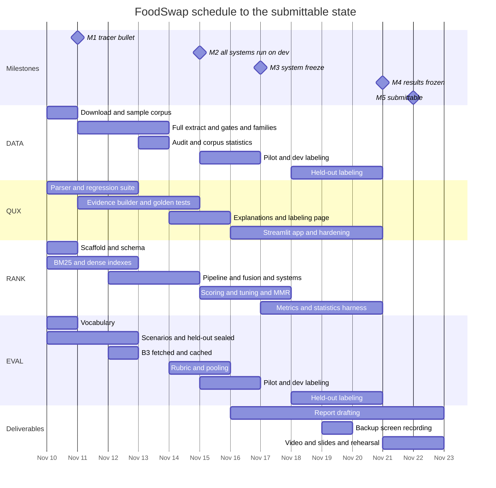

# 10 · Plan

**Use:** live. Update task status and dates here, or mirror tasks into GitHub issues and keep this file as the source of IDs.
**Read by:** everyone, first.
**Last updated:** 2026-11-10.

## 1. Constraints

| Constraint | Value |
|---|---|
| Deadline | Unknown; late November. The plan is **submittable on Sun Nov 22** and has buffer through Mon Nov 30. Ask the instructor for the exact date, report format and demo slot today (task T1.2). |
| Holidays | Thanksgiving is Thu Nov 26; assume no work Wed–Fri Nov 25–27 |
| People | 4, at 12–18 focused hours a week each |
| Capacity before Mon Nov 23 | 96–144 person-hours |
| Core estimate | 137.5 person-hours (section 4) |
| Deliverables | Demo video (3–4 min), live demo, written report, code repo with README |

Core fits only near the top of the capacity range. That is why Should, Stretch and the cut order exist ([01](01-scope-and-features.md#7-tiers-and-budget)).

## 2. Roles

Roles are assigned at kickoff (T1.2). Each role has a backup who can read its code.

| Role | Owns | Labels? | Core hours | Backup |
|---|---|---|---|---|
| **DATA** | Corpus, taxonomy, quality gates, families, audit, README and data card | Yes (assessor A) | 36.0 | RANK |
| **RANK** (tech lead) | Scaffold, indexes, pipeline, scoring, tuning, metrics and statistics | No | 34.75 | DATA |
| **QUX** | Parser, evidence engine, explanations, Streamlit app, labeling page | No | 36.75 | EVAL |
| **EVAL** | Vocabulary, scenarios, B3, rubric, pooling, labeling, statistics review, report editing, coordination | Yes (assessor B) | 30.0 | QUX |

RANK and QUX build the systems under test, so they never label and never see held-out requests ([09](09-evaluation.md#1-principles)).

## 3. Schedule

### 3.1 Milestones and freezes

| Date | Milestone or freeze | Done when |
|---|---|---|
| **Tue Nov 10** | Docs land. Schema and interfaces frozen. Download started. | `schema.py` merged; the 20K sample corpus exists |
| **Wed Nov 11** | **M1: tracer bullet** | B1 runs end to end on the sample through the CLI and a bare Streamlit page |
| **Thu Nov 12** | Scenarios frozen; held-out sealed; B3 fetched | 32 scenarios written; `b3_cache/` populated |
| **Fri Nov 13** | Corpus v1 frozen | Full US corpus with gates and families; audit generated |
| **Sun Nov 15** | **M2: every system emits dev runs.** Everything that affects rankings is frozen except the weights. | Runs for every system on dev; labeling page usable; pilot labeling done |
| **Tue Nov 17** | **M3: system freeze** | Weights tuned on dev; tag `eval-v1`; held-out runs and pool generated; pre-registration committed |
| **Fri Nov 20** | Labels frozen | Held-out double labeling adjudicated; κ computed |
| **Sat Nov 21** | **M4: results frozen.** UI frozen for recording. | Every table and figure regenerated from the tag; tag `results-v1` |
| **Sun Nov 22** | **M5: submittable** | Report v1, final video, slides, first rehearsal |
| Mon–Tue Nov 23–24 | Submit, or do Should items if the deadline is later | |
| Wed–Fri Nov 25–27 | Thanksgiving: assume no work | |
| Sat–Mon Nov 28–30 | Polish, second rehearsal, re-record only if the UI changed | |

### 3.2 Timeline

### 3.3 Critical path

download → extract → sample corpus → indexes → pipeline → corpus v1 → full indexes → dev runs → dev labels → tuning → **system freeze** → held-out pool → held-out labels → metrics → report and video

It has about one day of float, and the human labeling sits on it. Parser tests, the audit, UI polish, the data and method sections of the report, and the slides are off the critical path.

### 3.4 First 48 hours

- [ ] Email the instructor: exact deadline, report format and length, demo slot and length, video requirements.
- [ ] Assign roles; collect Thanksgiving availability; agree a 10-minute daily check-in.
- [ ] Read [decisions.md](decisions.md) together and confirm or change each proposed decision.
- [ ] Start the 8 GB Parquet download on the builder machine.
- [ ] Merge the scaffold and `schema.py`.
- [ ] Build the 20K sample corpus and share it.
- [ ] Start writing scenarios; EVAL keeps the held-out file private.

## 4. Core tasks (137.5 h)

| ID | Task | h | Owner | Needs | Acceptance |
|---|---|---|---|---|---|
| T1.1 | Project skeleton: package, pinned requirements, data download | 3 | RANK | – | `pip install -r requirements.txt` works on all four laptops. **Done Nov 14.** |
| T1.2 | Kickoff: deadline email, capacity, roles, decisions confirmed | 2 | all | – | Roles and deadline recorded here; decisions marked accepted |
| T2.1 | Download Parquet and four taxonomies; manifest | 2 | DATA | – | ≥ 4.8M rows, ≥ 0.95M US rows, checksum and revision recorded. **Done Nov 14.** |
| T2.2 | DuckDB extraction to the canonical schema, plus a sample | 6 | DATA | T2.1 | One command writes the corpus and the sample. **Done Nov 14** (349,308 products, 54 nutrients; 18,293 in the sample). |
| T2.3 | Quality flags and the searchable gate | 3 | DATA | T2.2 | The vandalized Cheerios and the Italian-language record are excluded; funnel written. **Done Nov 14.** |
| T2.4 | Taxonomy module, ancestor closure, comparison category, category postings | 4 | DATA | T2.1 | Comparison category computed for every searchable product. **Comparison category done Nov 14**; ancestor closure for ingredients comes with the evidence step. |
| T2.5 | Product families by exact key | 2 | DATA | T2.2 | The two Cheerios barcodes share a family; a reference's family is never returned. **Families done Nov 14.** |
| T2.6 | Missingness and coverage audit | 2 | DATA | T2.3 | `reports/data_audit.md` and the funnel figure come from a script |
| T3.1 | Constraint vocabulary | 2 | EVAL | – | The vocabulary covers the 11 items in [07](07-constraints-and-safety.md#2-vocabulary), with exceptions **Done Nov 14.** |
| T3.2 | Evidence builder and golden tests | 7 | QUX | T2.2, T2.4, T3.1 | Nutella fails milk and soy; missing ingredients give UNKNOWN; every verdict names its source; all exception tests pass **Done Nov 14** (11 allergens, 36 tests). |
| T3.3 | Nutrient features and within-category percentiles | 2 | DATA | T2.4 | Percentiles available per category and basis |
| T4.1 | Rule parser, query formulation, clarifications, 30-case suite | 6 | QUX | T1.1 | No negated term ever reaches the formulated query |
| T5.1 | Fielded BM25 (three `bm25s` indexes) | 4 | RANK | T2.2 | Index build and `score_all` on the sample; memory-mapped load **Done Nov 14.** |
| T5.2 | Dense index and exact masked search | 4 | RANK | T2.2 | Throughput measured on 10K before the full run **Done Nov 14** (about 400 products a second on the M4). |
| T5.3 | RRF, pipeline, systems, run and trace writer | 7 | RANK | T3.2, T4.1, T5.1, T5.2 | One command writes run, trace and settings for any system; ablations are settings, not code branches **RRF done Nov 14**; pipeline and run writer next. |
| T5.4 | Score S, dev grid tuner, family collapse, MMR | 5.5 | RANK | T5.3, T6.4 | Tuned weights recorded with the dev table |
| T5.5 | Explanations and why-not list | 3 | QUX | T5.3 | Faithfulness test passes on 1,000 random pairs |
| T5.6 | Two config-only baselines (X1, X2) | 3 | RANK 1.5; DATA, EVAL 0.75 each (labeling) | T5.3 | Presets only, no new code paths; first to be demoted to automatic metrics if labeling runs short |
| T6.1 | 32 scenarios, stratified by type | 5 | EVAL | sample corpus | 3 dev and 5 held-out per category; held-out sealed |
| T6.2 | B3 through OFF's search service, cached | 3 | EVAL | T6.1 | Raw responses saved; what cannot be expressed is tabulated |
| T6.3 | Rubric, labeling page, pooling and shuffling | 5 | EVAL 2.5, QUX 2.5 | T5.3 | Provenance hidden; B3 items outside the corpus are labelable; labels saved after every item |
| T6.4 | Pilot and dev labeling | 5 | DATA 2.5, EVAL 2.5 | T6.3 | Pilot κ computed; rubric revised once |
| T6.5 | Held-out double labeling, adjudication, κ | 10 | DATA 5, EVAL 5 | M3 | Consensus qrels and agreement statistics committed |
| T6.6 | Metrics and statistics harness | 5 | RANK | T6.3 | One evaluation command regenerates every table and figure from run folders and labels |
| T7.1 | Streamlit app: search, compare, footer | 9 | QUX | T5.5 | Reference lookup, chips, result cards, why-not drawer, system comparison |
| T7.2 | Demo hardening | 2 | QUX | T7.1 | Warm query under 1 s; cold start under 20 s; runs offline |
| T8.1 | Report | 14 | RANK 3, QUX 3, DATA 3, EVAL 5 (editor) | T6.6 | Outline in [11](11-deliverables.md#1-report); every number generated |
| T8.2 | Demo video | 5 | EVAL 2.5, QUX 2.5 | T7.2 | 3–4 minutes; storyboard in [11](11-deliverables.md#2-demo-video) |
| T8.3 | Slides and two rehearsals | 5 | all | – | Rehearsal 1 by Nov 22 |
| T8.4 | README, data card, reproducibility, attribution | 2 | DATA | – | Six-command quick start works on a clean clone |

## 5. Should tasks (31 h)

Done in this order, and only once the owner's Core tasks are finished.

| ID | Task | h | Owner | Report value |
|---|---|---|---|---|
| S1 | 300–500 template scenarios and paraphrase robustness | 4 | EVAL | The negation result at scale; coverage curves |
| S2 | Hand audit of ~100 allergen verdicts against label photos | 4 | DATA 2, EVAL 2 | A small, novel data-quality result |
| S3 | Convex-combination fusion vs. RRF | 2 | RANK | Tests a published claim at small scale |
| S4 | Editable chips and cached thumbnails | 4 | QUX | A better demo |
| S5 | Parser test set of ~150 requests, slot-level F1 | 4 | QUX 2, EVAL 2 | A component evaluation |
| S6 | Scaling curve at 10K, 100K and full | 3 | DATA | The "storage" chapter |
| S7 | Vegan and vegetarian; taxonomy-expanded ingredient exclusions | 5 | QUX | More request coverage |
| S8 | Sensitivity plots: weights, RRF k, θ vs. coverage | 2 | RANK | Robustness |
| S9 | Second embedding model on ≤100K products | 3 | RANK | Model comparison |

## 6. Working agreements

- **Daily:** a 10-minute check-in, written or spoken: done, next, blocked.
- **Syncs:** Fri Nov 13 (corpus and scenarios), Tue Nov 17 (freeze), Sat Nov 21 (results).
- **Git:** short-lived branches, pull requests with one reviewer, `main` always runs. Freezes are tags (`eval-v1`, `results-v1`).
- **Definition of done:** merged, tests pass, and docs updated if an interface or decision changed.
- **Decisions:** anything that changes a frozen item is added to [decisions.md](decisions.md) before the code changes.
- **No Should work before Core**, and no Stretch work before M4.
- **Docs:** after Nov 10 only [09](09-evaluation.md), this file and [decisions.md](decisions.md) are live. The rest change only through a logged decision.

## 7. Risks

| Risk | Early warning | Mitigation | Owner |
|---|---|---|---|
| Data cleaning swallows week 1 | No sample corpus by Wed Nov 11; schema still changing on Fri | Build the sample first; flag and exclude, never repair; two-pass extraction; hold the data tasks to their hours | DATA |
| The system freeze slips and labeling is squeezed | Labeling page unusable on Sun Nov 15; ranking commits after Nov 17 | Freeze by tag; later variants report judged@5 or automatic metrics only | RANK |
| Low assessor agreement | Pilot κ_w below 0.5 | Anchored examples per grade and category; one more calibration round; binary-collapsed sensitivity check | EVAL |
| The unknown-evidence rule leaves fewer than five eligible results | The audit shows low PASS rates for common allergens; over a quarter of dev scenarios fall short | Report it as a finding; references from populated categories; θ sensitivity; optional separate "unverified" section, off by default ([07](07-constraints-and-safety.md#6-the-cost-of-being-conservative)) | QUX |
| Laptop or demo fragility | Cold start over 20 s or memory over 10 GB on Nov 15; a teammate cannot install by Tuesday | One build machine and shared artifacts; caching and memory-mapping; four-category fallback corpus; recorded fallback video | QUX |
| Scope creep and planning theatre | More doc pages than passing tests on Fri Nov 13; someone compares models before B1 runs | No Should before Core; docs frozen after Tuesday except the live three | EVAL |
| A null result | On dev, P2 − B2 is within noise; the best weights sit on a corner of the simplex | Lead with violations, coverage and contamination, where effects are large; report relevance with intervals; an honest negative result is still a result | RANK |
| Validity holes a grader will catch | Violations are zero by construction; builders have read held-out requests | Human exclusion flags; sealed held-out set; pre-registration | EVAL |
| The dump changes or the download fails | Row count below the manifest check | Pin the revision; keep the downloaded file; the CSV export is a fallback | DATA |
| Someone is unavailable for days | Missed check-ins | Each role has a backup; tasks small enough to hand over | EVAL |
| The deadline is earlier than Nov 22 | Instructor's reply | Apply the cut order immediately | all |
